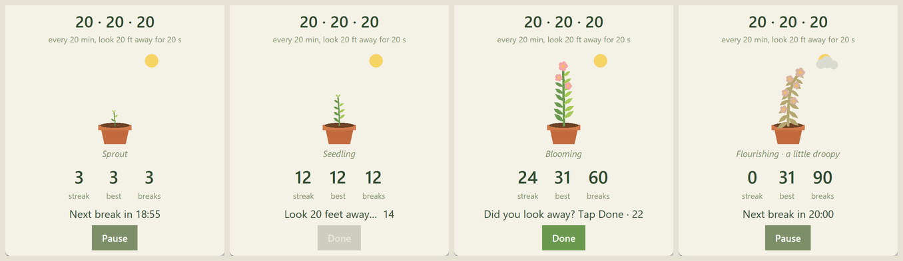

# twentyx3 🌱

A tiny desktop companion for the **20-20-20 rule**: every **20 minutes**, look at something **20 feet** away for **20 seconds**. Each break you take helps a little plant grow.



## Features

- **Gentle reminders.** Every 20 minutes the window jumps to the front and chimes.
- **Look-away timer.** A 20-second countdown, after which you confirm the break with **Done**.
- **Streaks.** Track your current streak and best streak. They're saved between sessions.
- **A plant that grows.** It goes from seed to a flourishing flowering plant as you complete breaks.
- **One file, no dependencies.** Only the Python standard library.

## Requirements

- **Python 3.8+** with **tkinter**.
  - **Windows / macOS:** tkinter is included with the python.org installers.
  - **Linux:** you may need to install it separately, e.g. `sudo apt install python3-tk`.

## Getting started

Clone the repo:

```bash
git clone https://github.com/natechuchu/twentyx3.git
cd twentyx3
```

Run it:

```bash
python twentyx3.py
```

On macOS/Linux you may need `python3` instead of `python`.

Press **Start** and get back to work. The app will let you know when it's time for a break.

### Try it quickly with demo mode

Waiting 20 minutes to see a reminder is slow, so demo mode shortens every timer:

```bash
python twentyx3.py --demo
```

## How it works

### The break cycle

1. **Start.** Press **Start** to begin a 20-minute work timer. **Pause** stops it, and pressing **Start** again restarts the full 20 minutes.
2. **Reminder.** When the timer ends, the window pops to the front of your screen and chimes.
3. **Look away.** A 20-second countdown runs while you look at something about 20 feet away. The **Done** button stays grayed out during this time.
4. **Confirm.** When the countdown ends, there's a second chime and **Done** turns green. You have **30 seconds** to tap it.
5. **Repeat.** The next 20-minute timer starts automatically.

| Outcome | Result |
| --- | --- |
| You tap **Done** within 30 seconds | Streak +1, total breaks +1, the plant grows |
| The 30 seconds run out | Streak resets to 0 and the plant droops |

Closing the app never breaks a streak. Only an unanswered reminder does.

### Streaks

- **streak**: breaks completed in a row, across sessions.
- **best**: your longest streak ever.
- **breaks**: total breaks completed, all time.

### The plant

The plant grows with your **total** breaks, so it never dies or shrinks:

| Breaks | Stage |
| --- | --- |
| 0 | Seed |
| 1+ | Sprout |
| 5+ | Seedling |
| 15+ | Young plant |
| 40+ | Blooming (flowers appear, with more every 10 breaks) |
| 80+ | Flourishing |

Growth is fast early on and slows over time, so there's always a little more to see. A broken streak makes the plant droop and fade, and a cloud covers the sun. Complete your next break to perk it back up.

The plant has no image files. It's drawn with shapes on a tkinter `Canvas` and redrawn about 12 times per second, which makes it sway gently.

## Configuration

All settings are constants near the top of [`twentyx3.py`](twentyx3.py):

| Setting | Default | Demo | Description |
| --- | --- | --- | --- |
| `WORK` | `20 * 60` | `10` | Seconds between breaks |
| `LOOK` | `20` | `5` | Seconds of the look-away countdown |
| `GRACE` | `30` | `5` | Seconds to tap **Done** before the streak breaks |
| `SAVE` | `twentyx3.json` | — | Where progress is stored |

Colors are defined just below these as hex values (`BG`, `LEAF`, `POT`, `BLOOM`, …) if you want to retheme the app.

## Saved data

Progress is saved to `twentyx3.json` in the same folder as the script:

```json
{"streak": 4, "best": 12, "total": 37, "wilted": false}
```

- **When it saves:** after every break (completed or missed) and when you close the window.
- **Resetting:** delete the file to start over with a fresh seed.
- **Keeping it out of git:** if you don't want to commit your personal stats, add `twentyx3.json` to `.gitignore`.

## Platform notes

- **Windows:** fully supported, including the chime and sharp rendering on high-DPI displays.
- **macOS / Linux:** everything works except the chime, which uses Windows-only `winsound`. The reminder still pops the window to the front.
